| | |
|---|---|
| **Student name** | _<your name>_ |
| **BITS ID** | _<your ID>_ |
| **Code repository** | _<GitHub repository URL>_ |
| **Demo video** | _<video link>_ |
| **API access** | Local Kubernetes (minikube) - see Section 9.3 |

# 1. Introduction

The goal of this assignment is to build a machine learning classifier that predicts whether a patient
has heart disease from routine clinical measurements, and to take it all the way to a monitored API
running on Kubernetes using MLOps practices: reproducible data processing, experiment tracking,
automated testing, CI/CD, containerisation, deployment and monitoring.

The dataset is the **UCI Heart Disease (Cleveland)** dataset with 303 patients and 13 input
features (age, sex, chest pain type, resting blood pressure, cholesterol, fasting blood sugar,
resting ECG, maximum heart rate, exercise-induced angina, ST depression, ST slope, number of major
vessels and thalassemia). The original target `num` (0-4) is converted into a binary label:
0 = no disease, 1 = disease present.

**Tools used:** Python 3.12, pandas, scikit-learn 1.5, MLflow 2.17, FastAPI, pytest, flake8,
GitHub Actions, Docker, minikube (Kubernetes v1.37), NGINX Ingress, Prometheus and Grafana.

# 2. Setup and installation

```bash
git clone <repository-url> && cd heart-disease-mlops
python3.12 -m venv .venv && source .venv/bin/activate
pip install -r requirements.txt
bash scripts/download_data.sh            # data
PYTHONPATH=src python -m heart.eda       # EDA figures
PYTHONPATH=src python -m heart.train     # training + MLflow
pytest -v                                # unit tests
docker build -t heart-api:1.0.0 .        # serving image
```

Two requirement files are used: `requirements.txt` (everything for development, training and
tests, all versions pinned) and `requirements-serve.txt` (only what the API needs), which keeps the
Docker image smaller. The full command list for Docker, Kubernetes and monitoring is in `README.md`.

# 3. Data acquisition and preprocessing

`scripts/download_data.sh` calls `src/heart/data.py`, which:

1. downloads `processed.cleveland.data` from the UCI repository (skipped if already present),
2. reads it with the documented column names and treats `?` as missing,
3. removes duplicate rows (none in this file, but the check is there for future data),
4. fills missing values - only **`ca` (4 rows)** and **`thal` (2 rows)** are missing, so they are
   filled with the column mode instead of dropping 2% of an already small dataset,
5. converts `num` to the binary `target` and casts the code-like columns to integers,
6. validates the result (all columns present, no NaN, binary target, positive age/cholesterol)
   and saves `data/processed/heart_clean.csv`.

Validation raises an error instead of silently continuing, so bad data stops the CI pipeline. The
model pipeline also contains its own imputers, so the API accepts requests where `ca` / `thal`
are unknown.

# 4. Exploratory data analysis

All plots are produced by `src/heart/eda.py` (and shown in `notebooks/01_eda.ipynb`) using a
consistent colour scheme: teal = no disease, coral = disease.

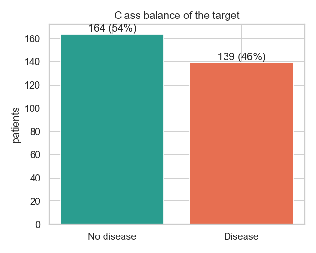{width=45%} 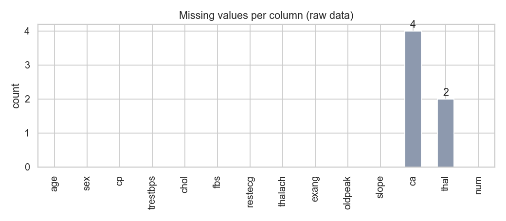{width=54%}

The classes are **reasonably balanced (164 / 139, i.e. 54% / 46%)**, so no resampling was needed;
a stratified train/test split and stratified cross-validation keep the ratio in every fold.

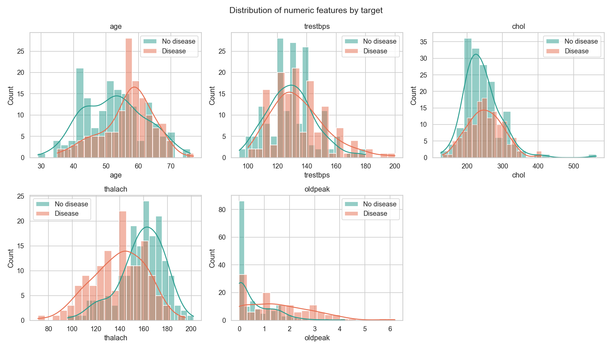{width=80%}

Patients with disease reach a **lower maximum heart rate (`thalach`)** and have a **higher ST
depression (`oldpeak`)**; they are also slightly older. Cholesterol and resting blood pressure look
very similar for both groups.

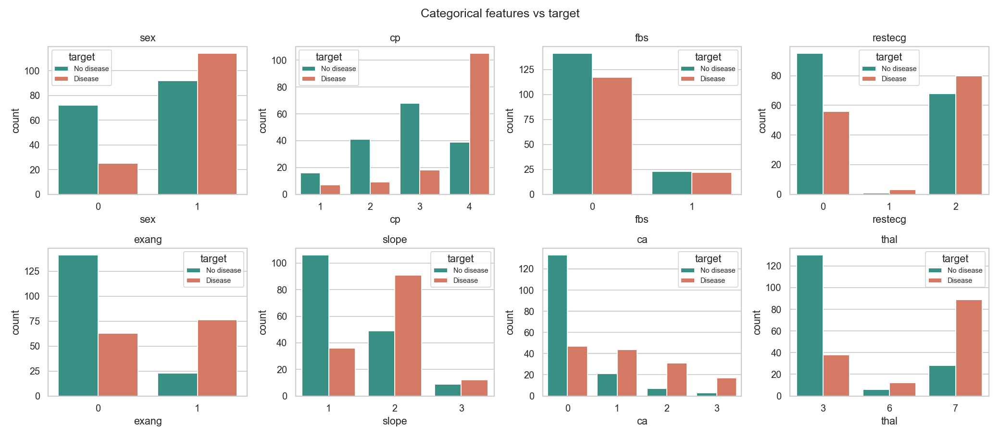{width=88%}

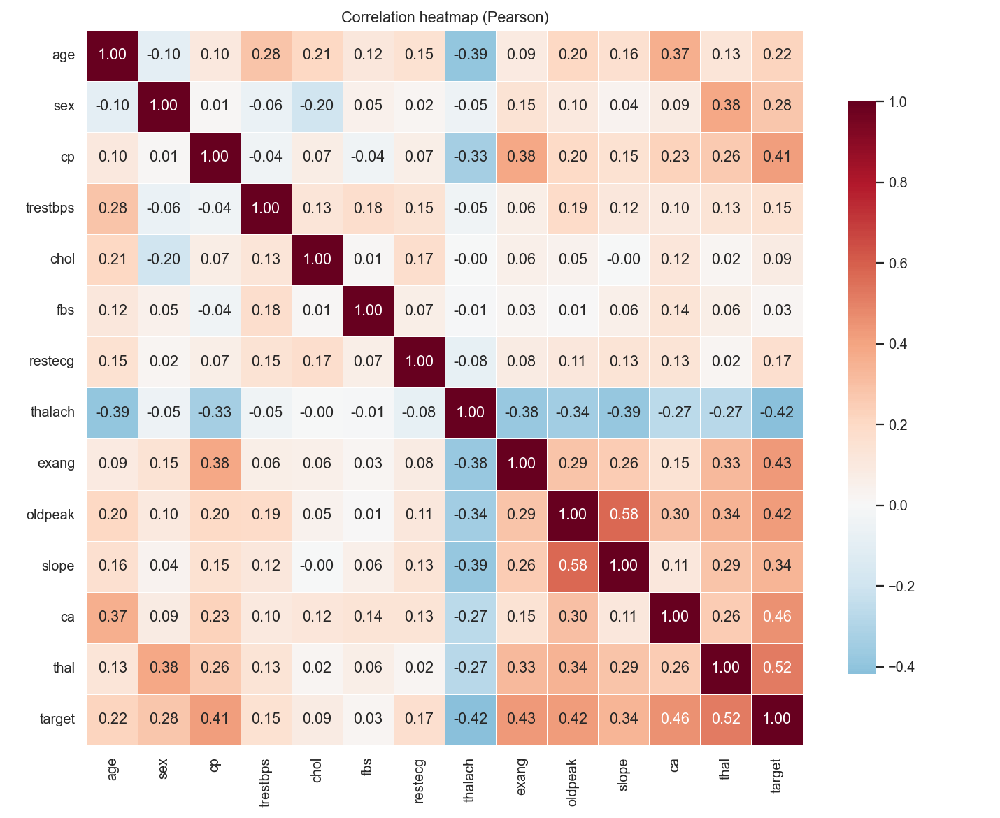{width=52%} 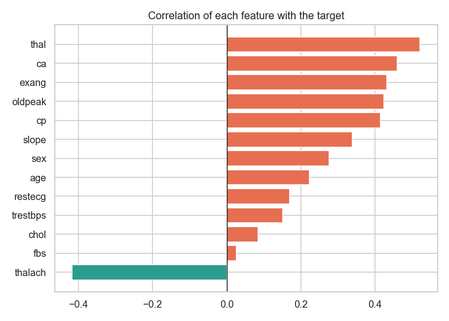{width=40%}

**Key findings**

* `cp = 4` (asymptomatic chest pain), `exang = 1`, `thal = 7` (reversible defect) and `ca > 0`
  are the strongest indicators of disease.
* `chol` and `fbs` are almost uncorrelated with the target.
* No pair of features is so strongly correlated (|r| > 0.6) that one has to be removed.
* Some outliers exist (e.g. cholesterol 564), but they are clinically possible, so they were kept.

# 5. Feature engineering and model development

## 5.1 Preprocessing pipeline

Everything that transforms the input is inside one scikit-learn `Pipeline`
(`src/heart/features.py`), which is saved together with the model. This means the training code,
the tests, the notebook and the API container all run exactly the same transformations, so there
is no train/serve skew.

| Step | Columns | Transformation |
|---|---|---|
| Feature engineering | `age`, `thalach` | new feature **`hr_pct_max = thalach / (220 - age)`** |
| Numeric | age, trestbps, chol, thalach, oldpeak, ca, hr_pct_max | median imputation + StandardScaler |
| Binary | sex, fbs, exang | most-frequent imputation |
| Categorical | cp, restecg, slope, thal | most-frequent imputation + One-Hot (unknown categories ignored) |

The engineered feature `hr_pct_max` is the share of the age-predicted maximum heart rate that the
patient reached in the exercise test. EDA showed that both age and `thalach` matter, and this
ratio combines them into one clinically meaningful value. `ca` is kept as numeric because it is an
ordered count (0-3).

## 5.2 Models and hyper-parameter tuning

Data is split 80/20 (stratified, `random_state=42`): 242 rows for training and 61 for a final
hold-out test. Three model families were tuned with `GridSearchCV` using **5-fold stratified
cross-validation** and **ROC-AUC** as the selection metric. ROC-AUC was used because it measures
how well the model ranks patients by risk independently of a single threshold.

| Model | Grid searched | Best parameters |
|---|---|---|
| Logistic Regression | C in {0.01, 0.1, 0.5, 1, 5}, penalty in {l1, l2} (10 candidates) | C = 0.5, l2 |
| Random Forest | n_estimators {100, 300}, max_depth {3, 5, None}, min_samples_leaf {1, 4} (12) | 100 trees, depth 5, leaf 4 |
| Gradient Boosting | n_estimators {100, 200}, learning_rate {0.05, 0.1}, max_depth {2, 3} (8) | 100, 0.05, depth 2 |

The grids are deliberately small: with only 242 training rows, a large search would mostly fit
the noise of the CV folds.

## 5.3 Results

The best estimator from each search was re-evaluated with 5-fold CV on the training set
(accuracy, precision, recall, F1, ROC-AUC) and once on the hold-out test set.

| Metric | Logistic Regression | Random Forest | Gradient Boosting |
|---|---|---|---|
| CV accuracy | **0.851** | 0.818 | 0.818 |
| CV precision | **0.887** | 0.844 | 0.827 |
| CV recall | **0.783** | 0.755 | 0.774 |
| CV F1 | **0.828** | 0.789 | 0.796 |
| CV ROC-AUC | **0.907 ± 0.020** | 0.897 ± 0.028 | 0.874 ± 0.025 |
| Test accuracy | 0.869 | 0.869 | **0.902** |
| Test recall | 0.929 | 0.929 | 0.929 |
| Test ROC-AUC | **0.960** | 0.958 | 0.959 |

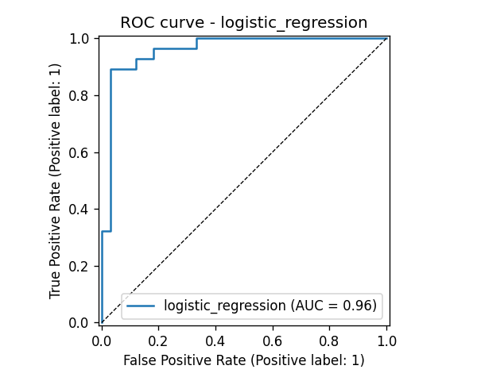{width=42%} 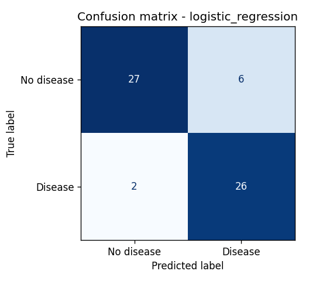{width=38%}

**Model selection.** The model is chosen on **mean CV ROC-AUC**, not on the test score, so the
test set stays an unbiased final check. **Logistic Regression** wins on every CV metric and also
has the lowest variance across folds. Gradient Boosting has a slightly higher test accuracy, but
the test set has only 61 patients (one patient = 1.6%), so this difference is not meaningful
compared to the CV results. Logistic Regression also gives well-behaved probabilities and
coefficients that a clinician can interpret, which matters for a medical use case. On the test
set it finds 26 of 28 disease cases (recall 0.93), which is the most important error type to
minimise in screening.

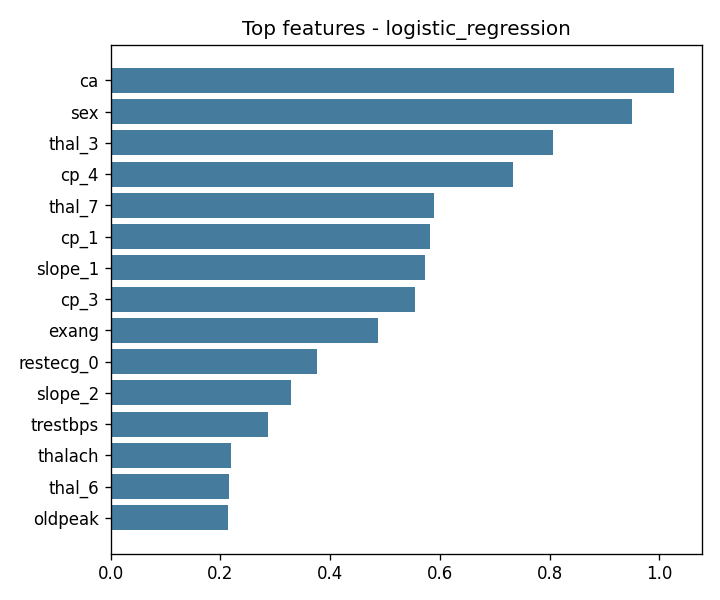{width=40%} 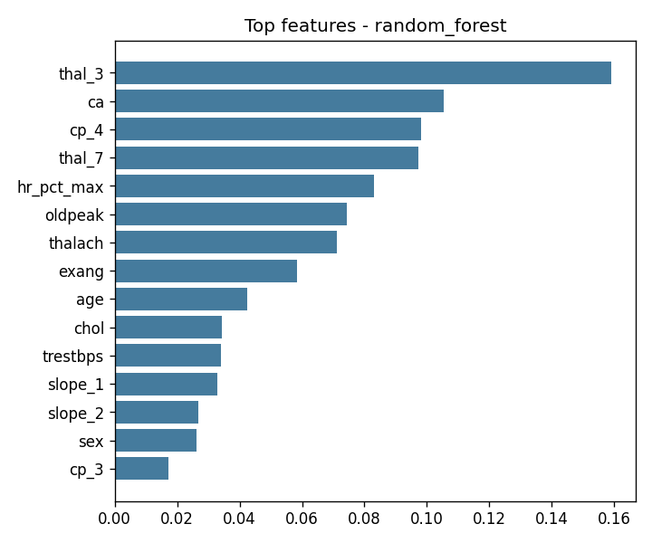{width=40%}

Both models agree with the EDA: `ca`, `thal`, `cp` and `oldpeak` are the most important inputs,
and the engineered `hr_pct_max` ranks among the top features for the Random Forest.

# 6. Experiment tracking (MLflow)

`src/heart/train.py` logs everything to a local MLflow tracking store (`./mlruns`):

* **one parent run per model family** with the best parameters, dataset sizes, all CV metrics
  (mean and std), all test metrics and the tuning time,
* **one nested child run for every grid candidate** (30 in total) with its parameters and CV
  ROC-AUC, so the whole tuning process can be compared in the UI,
* **artifacts:** confusion matrix, ROC curve, precision-recall curve, feature importance plot and
  the full CV results table (CSV),
* **the model** in MLflow format with an input example and signature,
* **tags** `model_family`, `stage`, and `selected_for_serving=true` on the winning run.

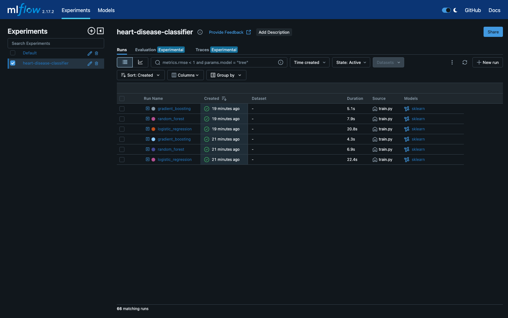{width=72%}

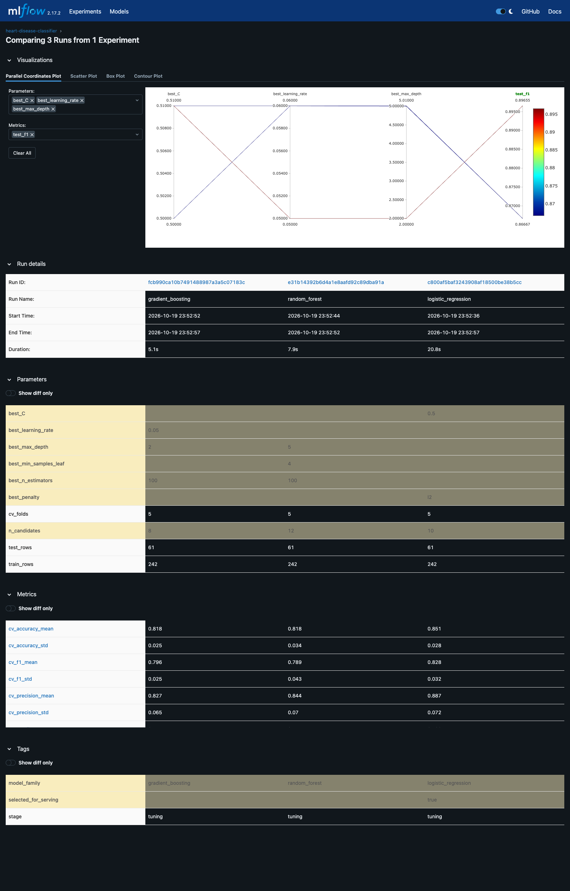{width=42%}

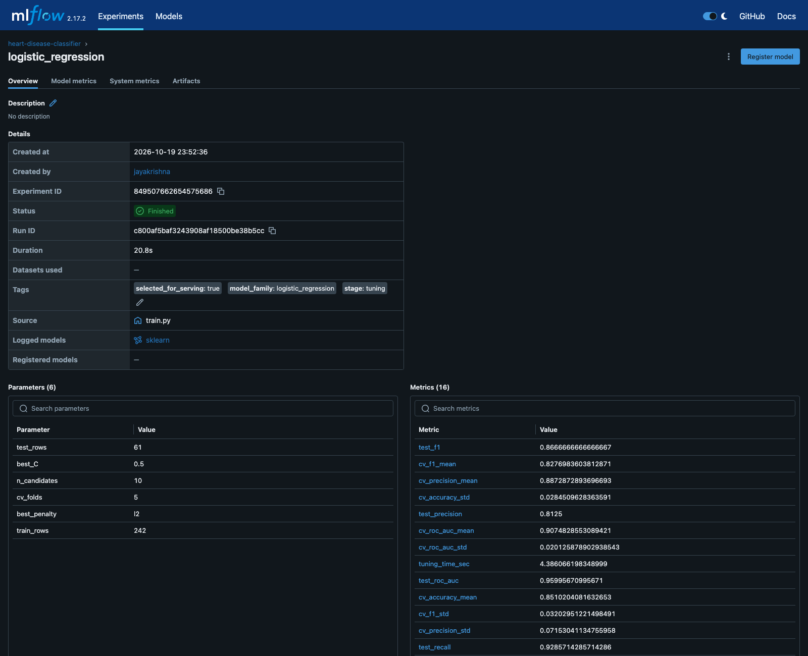{width=62%}

**Summary:** 2 complete training sessions were run (66 runs including nested ones). The results
were identical in both, which confirms that the pipeline is reproducible (fixed random seeds,
pinned library versions).

# 7. Model packaging and reproducibility

* **Model formats:** the winning pipeline is saved as `models/model.joblib` (used by the API) and
  as an MLflow model in `models/mlflow_model/` (contains `MLmodel`, `conda.yaml`,
  `requirements.txt`, input example and signature). `models/metadata.json` stores the model name,
  MLflow run id, best parameters, metrics and the feature list.
* **Preprocessing is part of the model**, so a client only sends raw patient values.
* **Pinned dependencies** in `requirements.txt` / `requirements-serve.txt`.
* **Fixed seeds** (`RANDOM_STATE = 42`) for the split, CV folds and models.
* **Single source of configuration** (`src/heart/config.py`) for paths and column lists.
* `scripts/predict.py` and `notebooks/03_inference.ipynb` show inference from the saved file.

# 8. CI/CD pipeline and automated testing

## 8.1 Unit tests

The `tests/` folder has **30 pytest tests**:

| File | What is tested |
|---|---|
| `test_data.py` (9) | duplicate removal, missing value filling, binary target, dtypes, validation errors, `?` parsing |
| `test_features.py` (5) | `hr_pct_max` values, no NaN after preprocessing, output width, unseen categories, feature names |
| `test_model.py` (5) | both model types train and predict valid probabilities, metrics, joblib round-trip, the full `train.main()` with MLflow in a temp folder |
| `test_api.py` (11) | `/health`, `/predict` (incl. optional fields), invalid inputs return 422, batch endpoint, `/metrics`, 503 when no model is loaded |

The tests use a small synthetic dataset, so they run in about 15 seconds and do not touch the real
model files.

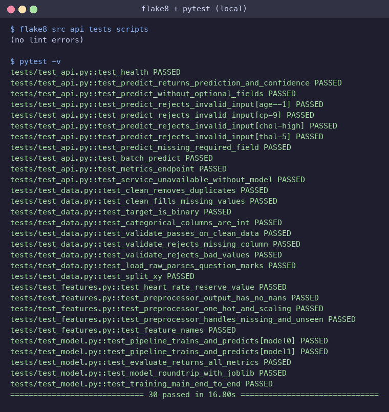{width=40%}

## 8.2 GitHub Actions workflow

`.github/workflows/ci.yml` runs on every push and pull request with four dependent jobs:

1. **Lint** - `flake8` over `src`, `api`, `tests`, `scripts`; report uploaded as an artifact.
2. **Unit tests** - `pytest -v --junitxml`; JUnit XML and log uploaded.
3. **Data + training** - downloads the dataset, trains all models, applies a **quality gate**
   (job fails if CV ROC-AUC < 0.80) and uploads the model, plots, training log and `mlruns/`.
4. **Docker** - builds the image with the freshly trained model, starts the container, waits for
   `/health`, calls `/predict` and checks the response; container logs are uploaded.

Because every job `needs` the previous one, a lint error, a failing test or a bad model stops the
pipeline with a red build and clear logs (`tee` + `exit ${PIPESTATUS[0]}` keeps the real exit
code while still saving the log).

_<Insert screenshot: GitHub Actions run with all four jobs green - `screenshots/02_github_actions_run.png`>_

_<Insert screenshot: artifacts of the run - `screenshots/03_github_actions_artifacts.png`>_

# 9. Containerisation and deployment

## 9.1 Docker

The `Dockerfile` uses `python:3.12-slim`, installs only `requirements-serve.txt`, copies `src/`,
`api/` and the model, runs as a **non-root user (UID 1000)**, has a `HEALTHCHECK` on `/health` and
starts `uvicorn` on port 8000.

The FastAPI service (`api/main.py`) exposes:

| Endpoint | Purpose |
|---|---|
| `POST /predict` | JSON patient record -> `prediction`, `label`, `confidence`, `probability_disease`, `risk_level`, `model_version` |
| `POST /predict/batch` | up to 100 patients |
| `GET /health` | liveness/readiness probe (503 if the model is not loaded) |
| `GET /model-info` | contents of `metadata.json` |
| `GET /metrics` | Prometheus metrics |
| `GET /docs` | Swagger UI |

Input validation is done with Pydantic (value ranges and allowed category codes from the UCI
documentation), so invalid requests get a clear HTTP 422 error. `confidence` is the probability
of the predicted class.

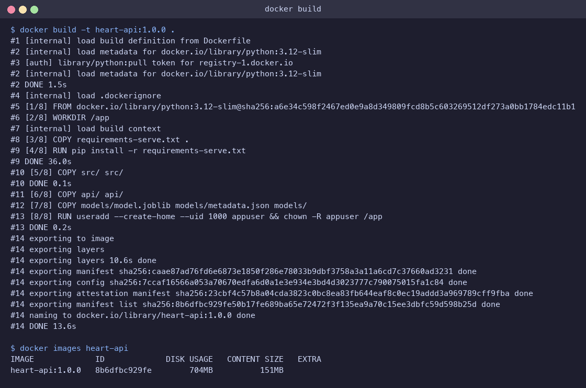{width=52%}

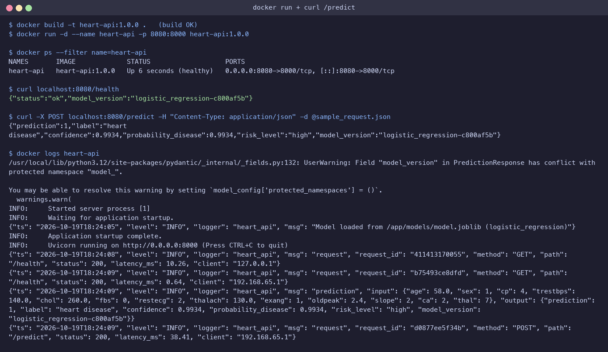{width=82%}

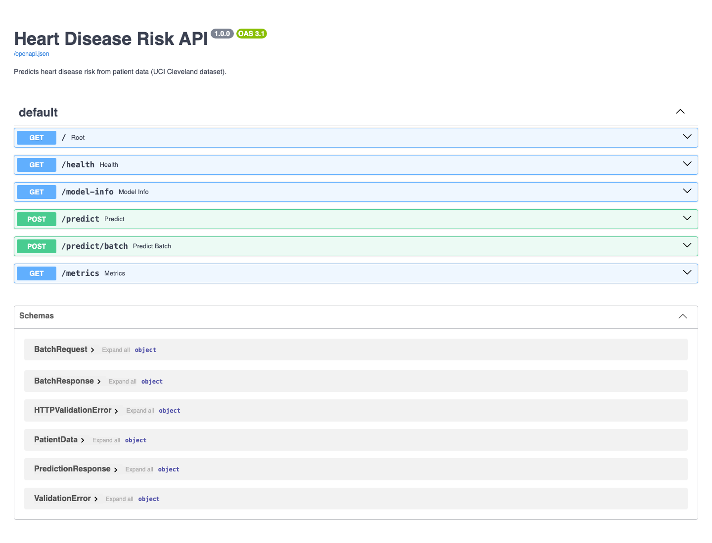{width=55%}

## 9.2 Kubernetes manifests (`k8s/`)

| File | Resource |
|---|---|
| `00-namespace.yaml` | namespace `heart-mlops` |
| `01-configmap.yaml` | `LOG_LEVEL`, `MODEL_PATH` |
| `02-deployment.yaml` | 2 replicas, rolling update (maxUnavailable 0), readiness + liveness probes on `/health`, CPU/memory requests and limits, `runAsNonRoot`, Prometheus scrape annotations |
| `03-service.yaml` | `LoadBalancer` service on port 80 |
| `04-ingress.yaml` | NGINX Ingress, host `heart-api.local` |
| `05-hpa.yaml` | HorizontalPodAutoscaler, 2-4 replicas at 70% CPU |

## 9.3 Deployment on minikube and verification

The image is loaded into the cluster with `minikube image load` and deployed with
`kubectl apply -f k8s/`. The endpoints were verified through **both** the LoadBalancer service
(`minikube service ... --url`) and the NGINX Ingress (port-forward of the ingress controller with
`Host: heart-api.local`):

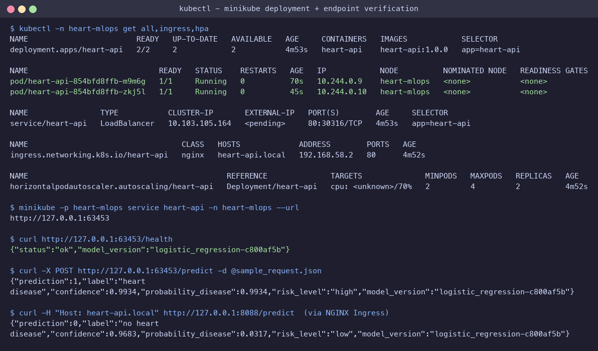{width=85%}

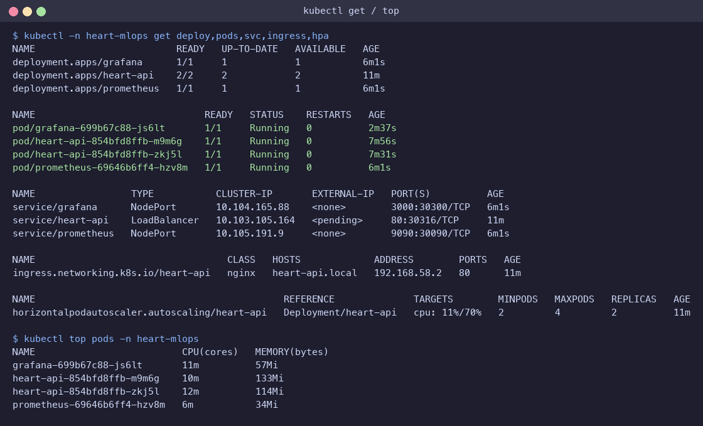{width=62%}

**Access instructions (local):** run `minikube -p heart-mlops tunnel` in a separate terminal; the
LoadBalancer then gets `127.0.0.1` as external IP and the API is reachable at
`http://127.0.0.1/predict`. Without the tunnel, use
`minikube -p heart-mlops service heart-api -n heart-mlops --url`.

# 10. Monitoring and logging

**Logging.** A FastAPI middleware writes one JSON line per request (request id, method, path,
status, latency in ms, client IP) and the `/predict` handler logs the input and output of every
prediction. A request id is returned in the `x-request-id` header, so a client error can be
matched to the log line. Logs are written to stdout and read with `kubectl logs`.

**Metrics.** `prometheus-client` exposes:

* `api_requests_total{method, endpoint, status}` - request counter,
* `api_request_latency_seconds` - latency histogram per endpoint,
* `model_predictions_total{label}` - predictions per class,
* `model_probability_disease` - histogram of predicted probabilities (useful to spot drift),
* `model_loaded` - 1 when the model is loaded.

**Prometheus** runs inside the cluster and discovers the API pods automatically through the
Kubernetes API (role-based access limited to the namespace) using the `prometheus.io/*` pod
annotations, so new replicas created by the HPA are scraped without changing the config.
**Grafana** is provisioned from code with the Prometheus datasource and a dashboard JSON
(`monitoring/grafana/dashboards/heart-api.json`). Traffic was generated with
`scripts/generate_traffic.py` (≈5% deliberately invalid requests to show errors).

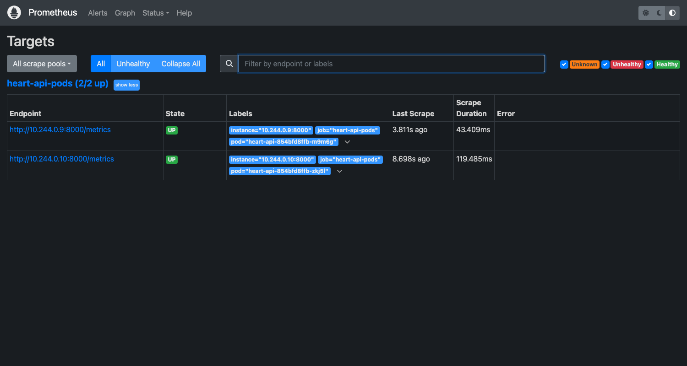{width=65%}

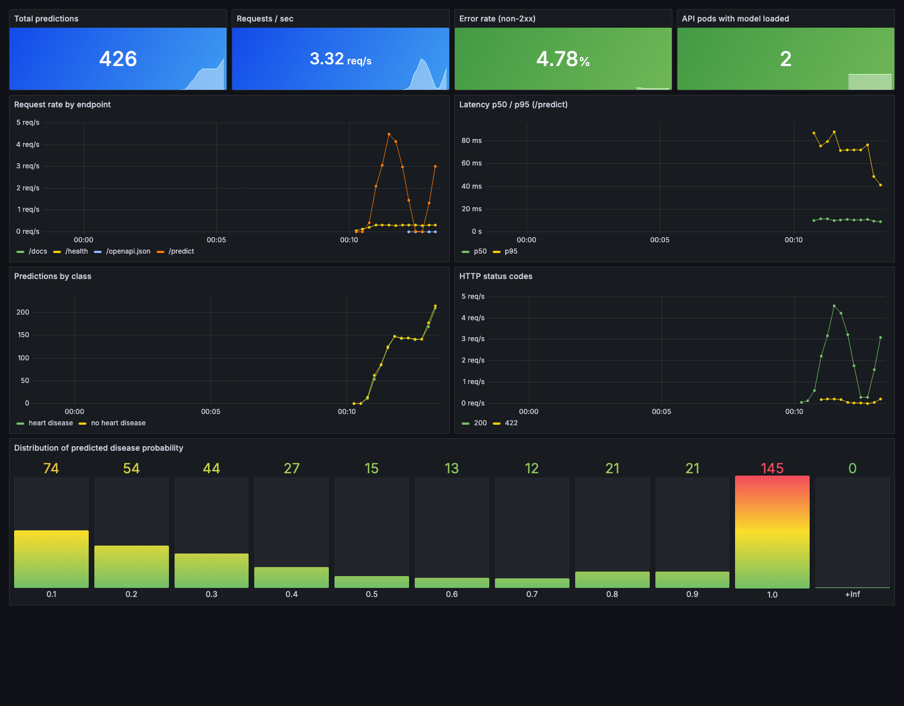{width=85%}

# 11. Architecture

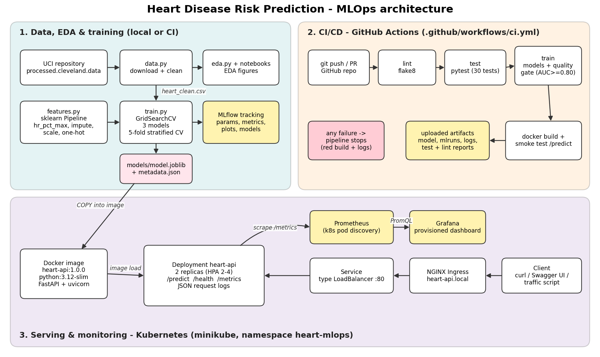{width=100%}

The system has three parts: (1) data processing, EDA and training with MLflow tracking, (2) a
GitHub Actions pipeline that lints, tests, retrains with a quality gate and builds/tests the Docker
image, and (3) serving on Kubernetes: Ingress -> Service -> 2-4 API pods, scraped by Prometheus
and visualised in Grafana.

# 12. Challenges and lessons learned

* **SSL error when downloading the data** - the python.org build of Python on macOS has no CA
  certificates. Fixed by using the `certifi` bundle in the download code instead of changing
  system settings.
* **Pods stuck in `CreateContainerConfigError`** - the deployment requires `runAsNonRoot`, but the
  image used a *named* user (`appuser`), which Kubernetes cannot verify. Fixed by giving the user a
  fixed UID (1000) in the Dockerfile and setting `runAsUser: 1000`.
* **Existing minikube cluster would not start** (API server never came up) and ports 8000/9090
  were already in use - a separate minikube profile (`heart-mlops`) and different host ports
  were used instead.
* **Re-running training from a notebook** re-exported the model with a new run id, which no longer
  matched the deployed image. The training notebook now reads results from MLflow, and training
  only runs through the script / CI. Lesson: there should be exactly one place that produces the
  served model.
* **HPA showed `<unknown>` CPU** until the `metrics-server` addon was enabled.

# 13. Conclusion and future work

A complete, reproducible pipeline was built: the selected Logistic Regression model reaches
**0.907 CV ROC-AUC (0.960 on the hold-out set)** and is served by a validated, monitored FastAPI
service on Kubernetes, with every change checked by a four-stage CI pipeline.

Possible improvements: use the MLflow Model Registry with a database backend for model stage
transitions; push images to a container registry and add a CD job that deploys to a cloud cluster
(GKE/EKS); add data-drift detection on the logged inputs (e.g. Evidently); calibrate the decision
threshold for higher recall; and train on the other UCI sites (Hungary, Switzerland, VA) to test
generalisation.

# References

1. Janosi, A., Steinbrunn, W., Pfisterer, M., Detrano, R. (1989). *Heart Disease* [Dataset]. UCI
   Machine Learning Repository. https://doi.org/10.24432/C52P4X
2. scikit-learn documentation - https://scikit-learn.org
3. MLflow documentation - https://mlflow.org/docs/latest
4. FastAPI documentation - https://fastapi.tiangolo.com
5. Kubernetes documentation - https://kubernetes.io/docs
6. Prometheus and Grafana documentation - https://prometheus.io/docs, https://grafana.com/docs
